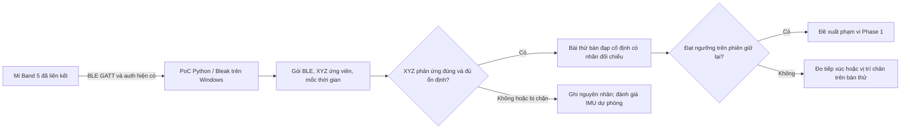

# Bản đồ dự án

## Luồng dữ liệu và quyết định

## Vị trí công việc

| Tệp | Trách nhiệm |
|---|---|
| [miband5_probe.py](miband5_probe.py) | Quét và chọn vòng theo địa chỉ, kiểm kê GATT, xác thực AES, điều khiển phiên, thu gói, giải mã XYZ ứng viên, ghi mốc và thống kê |
| [requirements.txt](requirements.txt) | Phiên bản Bleak và PyCryptodome |
| [BAO-CAO.md](BAO-CAO.md) | Bốn nguồn tham chiếu theo commit, định dạng gói, bằng chứng và giả thuyết, giao thức thử bàn đạp, ngưỡng và phương án dự phòng |
| [KIEM-TRA-WINDOWS.md](KIEM-TRA-WINDOWS.md) | Thao tác và xử lý lỗi trên PC có Bluetooth |
| [TIMELINE.md](TIMELINE.md) | Trình tự công việc, điều kiện qua cổng và thời lượng ước tính |
| [HANDOFF.md](HANDOFF.md) | Việc kế tiếp cho AI và mẫu ghi kết quả thực địa |
| [AGENTS.md](AGENTS.md) | Ràng buộc làm việc cho agent trong repo |
| [LICENSE-Erencv.txt](LICENSE-Erencv.txt) | Thông báo giấy phép MIT cho phần auth và UUID chuyển thể từ nguồn Erencv |

Mỗi phiên capture tạo thư mục cục bộ trong `runs/`. `run.log` ghi trạng thái kết nối và chỉ số luồng. `packets.csv` giữ payload hex của control/data để tra lại định dạng. `samples.csv` có một hàng trên mỗi bộ XYZ ứng viên. `markers.csv` dùng cùng đồng hồ nhận của PC với gói. Hai CSV gói và mẫu nối qua `packet_id`. Ghép video/công tắc ở bước phân tích để xác nhận nhãn và biên chuyển động.
